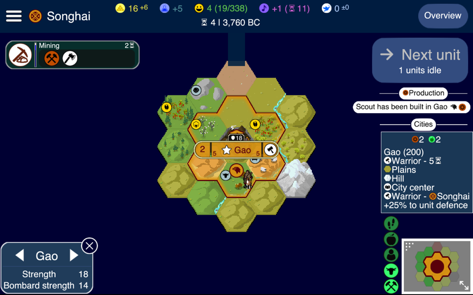

# Unciv in the browser (web module)

This module compiles Unciv to JavaScript with [TeaVM](https://teavm.org), using
[gdx-teavm](https://github.com/xpenatan/gdx-teavm) 1.6.2 as the libGDX backend (WebGL, input, audio, asset preloading).
It is not the noVNC streaming setup in `web-stream/`: here the game itself runs in the page.

Status: **phase 2.** In Chrome you can start a single-player game, play turns, save it, reload the page
and load it back. Settings and saves stay in the browser's storage (IndexedDB).



## Building and running

```
./gradlew web:dist   # -> web/build/dist/js/webapp
./gradlew web:run    # same, then serves it on http://localhost:8080
```

Any static file server works for `web/build/dist/js/webapp`, e.g. `python3 -m http.server -d web/build/dist/js/webapp`.

The build needs JDK 17+ (gdx-teavm and TeaVM's class library require it) and takes 2-4 minutes;
TeaVM gets 8 GB (`processMemory`). The output is not optimized yet: `app.js` is about 80 MB
(`optimization = NONE`, no obfuscation) and the assets about 35 MB, all preloaded before the game starts.

## How it works

Core is unchanged in behaviour. The JVM-only parts are kept out of the browser build at compile time:

- **Substitutions** (`UncivSubstitutionPolicy`, TeaVM's `SubstitutionPolicy`): class `a.b.C` is compiled as
  `unciv.webemu.a.b.C` instead. Used for
  - `kotlinx.coroutines.Dispatchers` and `runBlocking`: everything runs on the page's single thread through
    `WebDispatcher` (a queue drained from `setTimeout`, a few ms at a time). `runBlocking` drains that queue until
    its block is done.
  - `com.unciv.utils.ThreadPools` and `com.unciv.logic.HttpEngine`, two small seams added to core for this:
    Concurrency's thread pools and the ktor engine (CIO on the JVM).
  - `kotlinx.coroutines.internal.StackTraceRecoveryKt`, `org.slf4j.LoggerFactory`: both need real JVM stack
    frames or class loaders.
  - JDK classes TeaVM doesn't have: `AtomicReferenceArray`, `ReentrantReadWriteLock`, `LockSupport`,
    `RejectedExecutionException`, `ConnectException`, `DosFileAttributes`, `MessageDigest` (SHA-1 only),
    `Collator` (case-insensitive compare), `java.awt.Rectangle`.
- **Method patches** (`UncivTeaVMPlugin`): methods missing from TeaVM's version of a JDK class are copied in from
  `unciv.webpatch.*`: `Locale.forLanguageTag`, `UUID(long, long)`, `Base64` stream wrappers, `Field.getFloat`,
  `Package.getSpecificationVersion`, `Thread.enumerate` / `setContextClassLoader`, `ClassLoader.loadClass`,
  `SecureRandom.getInstanceStrong`, `File.toPath`, `Charset.isSupported`, `Pixmap(ByteBuffer)`.
  `Throwable.stackTraceToString()` is replaced so crash reports carry the JavaScript stack.
  `ThreadLocalRandom.setSeed` becomes a no-op: TeaVM's version throws from it during its own static init,
  so `current()` returned null and Kotlin's `Random.Default` crashed.
  libGDX's `Field` (gdx-teavm's version) gets real `isTransient`/`isStatic`/... answers and reads collection
  element types from TeaVM's generic signatures; without that, Json wrote `@Transient` fields into saves and
  read list or map elements back as raw maps.
  The plugin also works around a TeaVM 0.15 crash in its reflection metadata (NPE in
  `ClassInfoGenerator.writeSimpleConstructors`) by keeping classes that reach `Class.newInstance()`.
- **Reflection**: gdx-teavm's list (`reflection(...)` in `build.gradle.kts`) covers `com.unciv.models.**`.
  The game state, `com.unciv.logic`, goes through `SaveReflectionSupplier` instead, which only exposes fields
  and constructors: gdx-teavm's list exposes every method, and for `com.unciv.logic.**` that ran TeaVM out of memory.
- **Local files**: gdx-teavm keeps them in IndexedDB but reports 0 as modification date. `WebLocalFiles` wraps
  `Gdx.files` and keeps the dates in `localStorage`, so the save list is sorted and old autosaves are purged
  as on desktop.
- **Platform classes**: `WebLauncher`, `WebGame`, `WebFont` (glyphs drawn on an offscreen 2D canvas, the browser
  does font fallback), `WebLogBackend` (browser console), `WebDisplay`.

Small changes in core, all behaviour-preserving on the JVM:
`Log.getTag` copes with an empty stack trace, `TranslationCache` copes with `DecimalFormat` returning null affixes,
`KeyboardBinding.unCamelCase` doesn't use a regex replacement string (TeaVM rejects references to unmatched groups),
`UncivFiles` only asks for external files when external storage exists, and its debug logs fall back to the
plain path where `FileHandle.file()` isn't available.

## What works

- Loading: assets, atlases, skin, rulesets (Vanilla + G&K), translations
- Language picker and main menu, including the background map generation and its tile graphics
- Text rendering through the canvas font, mouse input
- Starting a new single-player game, playing turns (a few dozen ms per turn on a small map at the start)
- Autosaves, manual saves, the Load game screen and Resume, also after reloading the page
- Settings kept across reloads

## What doesn't (yet), roughly in the order to tackle it

- **Network**: `WebHttpEngine` refuses every request, so multiplayer, mod downloads and update checks fail
  ("Couldn't connect to server" in the log). Next step: a ktor engine on top of `fetch()`.
- **Save files**: saves can't leave the browser yet. "Save to / Load from custom location" have no backend
  (`PlatformSaverLoader.None`), only the clipboard works. Clearing site data deletes the saves.
  No `FileType.External`, no `FileHandle.file()`: code outside the save path that calls it still throws.
- **Turns**: next-turn computation runs on the page's only thread, so the page freezes while the AI plays.
  Fine on a small map early on; a Web Worker is the real fix.
- **runBlocking** can't wait for timers, network or GL-thread work; it throws instead of freezing the tab.
- **Reflection** covers `com.unciv.models.**` and the game state. Code elsewhere that reflects on its own
  classes will fail with `NoSuchFieldException` and needs adding.
- **Display glitches** seen in the world screen: a dark rectangle under the top bar, and the first letter of
  some popup texts missing.
- **Fonts**: mod fonts (`FontFamilyData.filePath`) aren't loaded, the options only offer CSS generic families.
- **Collator**: no locale-aware sorting.
- **Audio**: untested, no music found at startup (as on a fresh desktop install).
- WebGL warns `glTexParameterf: Texture filter not recognized` (the atlases ask for a mipmap mag filter);
  harmless so far.
- Size and speed: no TeaVM optimization, no asset trimming, everything preloaded.

## Debugging

Crashes show the JavaScript stack on the crash screen and in the console. TeaVM names are mangled but readable:
`culf_UncivFiles_getSave` is `com.unciv.logic.files.UncivFiles.getSave`.
In a hidden tab or headless Chrome, `requestAnimationFrame` gets throttled to about one frame per second, and
gdx-teavm waits 60 frames before the first render, so the page stays black for a while there.
